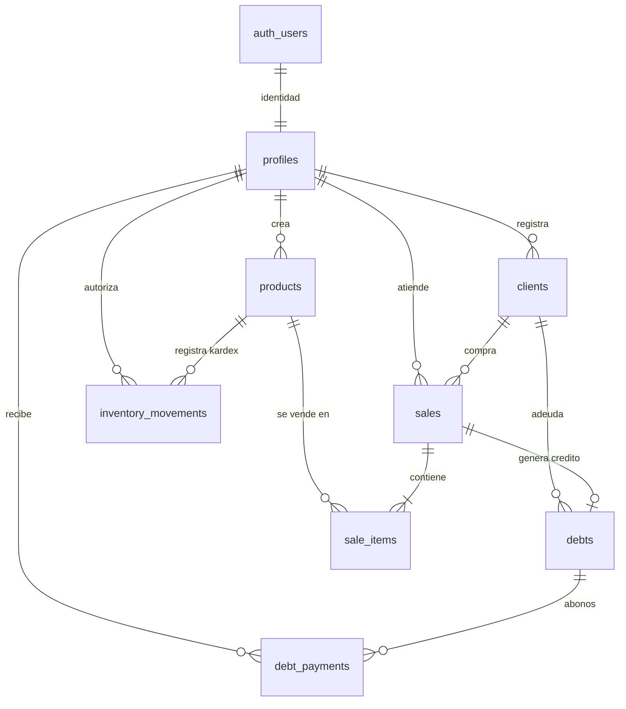

# ⚡ Trueno 219 — Backend de Inventario, Ventas, Cartera y Clientes

Backend robusto, transaccional y escalable para el sistema de punto de venta e inventario **Trueno 219**, construido con **Next.js (App Router)**, **TypeScript**, **Supabase PostgreSQL**, **Supabase Auth** y validación de esquemas con **Zod**.

---

## 1. Arquitectura del Sistema

El backend sigue el patrón arquitectónico **MVC adaptado a Next.js App Router**:

```
trueno-backend/
├── src/
│   ├── app/
│   │   ├── api/                   # Rutas REST de Next.js (Endpoints)
│   │   │   ├── auth/              # Registro, Login, Logout, Me, Forgot-Password
│   │   │   ├── products/          # Inventario, ajuste de stock, traslado tienda/bodega
│   │   │   ├── clients/           # Directorio de clientes, historial de ventas y deudas
│   │   │   ├── sales/             # Registro atómico de ventas, historial, anulaciones
│   │   │   ├── debts/             # Cartera, abonos transaccionales, resumen
│   │   │   ├── pending-sales/     # Preventas / borradores y confirmación atómica
│   │   │   ├── settings/          # Configuración comercial (moneda, alertas, umbrales)
│   │   │   ├── dashboard/         # KPIs, productos más vendidos, ventas por período
│   │   │   └── migration/         # Migración segura desde localStorage hacia Supabase
│   │   ├── layout.tsx
│   │   └── page.tsx               # Monitor de estado de la API
│   ├── controllers/               # Controladores HTTP y orquestación
│   ├── services/                  # Lógica de negocio y cálculo de totales en servidor
│   ├── repositories/              # Consultas y acceso directo a datos
│   ├── lib/supabase/              # Clientes Supabase (Público, Autenticado y Service Role)
│   ├── schemas/                   # Esquemas de validación Zod
│   ├── types/                     # Interfaces y tipos TypeScript
│   └── utils/                     # Respuestas estandarizadas y gestión de errores
├── supabase/
│   └── migrations/
│       ├── 20261025_001_initial_schema.sql         # Tablas, índices, claves foráneas y RLS
│       └── 20261025_002_atomic_rpc_functions.sql   # Funciones transaccionales (RPC) en PL/pgSQL
├── frontend-integration/          # Capa de servicios HTTP y store adaptado para Vue 3
│   └── src/
│       ├── services/              # Clientes de API para Vue
│       └── stores/store.js        # Store central reactivo conectado al backend
├── tests/                         # Suite de pruebas automatizadas
├── .env.example                   # Plantilla de variables de entorno
└── package.json
```

---

## 2. Diagrama Entidad-Relación (Base de Datos)



---

## 3. Operaciones Transaccionales Atómicas (RPC PostgreSQL)

Para evitar condiciones de carrera (*race conditions*) y descuadres financieros, las siguientes operaciones se ejecutan dentro del motor PostgreSQL con bloqueo pesimista (`FOR UPDATE`):

1. **`register_sale_atomic`**: Bloquea las filas de productos, valida stock suficiente, recalcula en servidor subtotal, descuento, interés y total; descuenta existencias en tienda; inserta la venta, los detalles de venta (`sale_items`), el kardex de auditoría (`inventory_movements`) y, si es venta a crédito, crea la deuda inicial con su primer abono en una sola transacción ACID.
2. **`register_debt_payment_atomic`**: Bloquea la deuda, valida que el abono sea mayor a cero y no supere el saldo pendiente, registra el abono inmutable en `debt_payments`, actualiza el saldo y estado de la deuda (`pagada` si llega a 0) y sincroniza el total abonado en la venta asociada.
3. **`transfer_stock_atomic`**: Traslada unidades entre tienda y bodega descontando de la ubicación origen y sumando en la de destino simultáneamente, auditando el movimiento en el kardex.
4. **`confirm_pending_sale_atomic`**: Valida que la preventa no haya sido confirmada antes (idempotencia), verifica existencias actuales de inventario y la convierte en venta definitiva.
5. **`cancel_sale_atomic`**: Anula la venta, devuelve las unidades al stock en tienda, crea registros de reverso en `inventory_movements` y anula deudas pendientes asociadas.

---

## 4. Instalación y Configuración

### Requisitos Previos
* Node.js v18+ (recomendado v20+ o v24+)
* Una cuenta de Supabase con un proyecto activo

### Paso 1: Clonar y configurar variables de entorno
1. Copia `.env.example` a `.env`:
   ```bash
   cp .env.example .env
   ```
2. Configura tus claves de Supabase en `.env`:
   ```env
   PORT=3001
   NEXT_PUBLIC_SUPABASE_URL=https://TU_PROYECTO.supabase.co
   NEXT_PUBLIC_SUPABASE_ANON_KEY=tu_clave_anonima_publica
   SUPABASE_SERVICE_ROLE_KEY=tu_clave_privada_service_role
   FRONTEND_URL=http://localhost:5173
   ```

### Paso 2: Ejecutar las Migraciones en Supabase
1. Ingresa a tu panel de Supabase: **SQL Editor**.
2. Copia y ejecuta el contenido de `supabase/migrations/20261025_001_initial_schema.sql`.
3. Copia y ejecuta el contenido de `supabase/migrations/20261025_002_atomic_rpc_functions.sql`.

### Paso 3: Instalar dependencias e iniciar el servidor
```bash
npm install
npm run dev
```
El servidor backend arrancará en `http://localhost:3001`.

---

## 5. Ejecutar Pruebas Automatizadas

Para validar las reglas de negocio, esquemas de validación Zod, restricciones de inventario y cálculos financieros:

```bash
npm test
```

---

## 6. Conexión del Frontend Vue 3

Los servicios HTTP y el store adaptado ya han sido configurados y se encuentran listos en `frontend-integration/`:
* `src/services/api.js`: Cliente centralizado que inyecta automáticamente el token JWT y maneja expiración de sesión.
* `src/services/index.js`: Servicios para productos, clientes, ventas, deudas, configuración y migración.
* `src/stores/store.js`: Store reactivo que mantiene el 100% de los métodos que las vistas existentes utilizan (`addProduct`, `adjustStock`, `transferStock`, `registerSale`, `addPayment`, `updateConfig`, etc.), persistiendo los datos de manera asíncrona en la base de datos relacional.

En el frontend Vue (`trueno-frontend` / `inventario-trueno`), asegúrate de tener en su archivo `.env`:
```env
VITE_API_URL=http://localhost:3001/api
```

---

## 7. Procedimiento de Migración desde localStorage

Para migrar los productos, clientes, ventas históricas y deudas existentes en los navegadores de los usuarios hacia PostgreSQL:

1. Inicia sesión en el sistema como administrador.
2. Llama al método de migración desde el frontend:
   ```javascript
   import { store } from '@/stores/store';
   await store.migrateFromLocalStorage();
   ```
   O envía una petición HTTP POST a:
   ```http
   POST /api/migration/import
   Authorization: Bearer <TOKEN_ADMIN>
   Content-Type: application/json

   {
     "products": [...],
     "clients": [...],
     "sales": [...],
     "debts": [...],
     "pendingSales": [...],
     "config": {...}
   }
   ```
3. El servicio resolverá automáticamente la correspondencia entre los IDs antiguos y los nuevos UUIDs, creará los registros históricos y generará un informe detallado de importados y omitidos por duplicidad.

---

## 8. Ejemplos de Solicitudes y Respuestas de la API

### Iniciar Sesión
```http
POST /api/auth/login
Content-Type: application/json

{
  "email": "admin@trueno219.com",
  "password": "Password123!"
}
```
**Respuesta (200 OK):**
```json
{
  "success": true,
  "message": "Inicio de sesión exitoso",
  "data": {
    "user": {
      "id": "76159c63-b187-4340-9a3b-1bca354876e5",
      "full_name": "Administrador Trueno",
      "email": "admin@trueno219.com",
      "role": "admin",
      "is_active": true
    },
    "token": "eyJhbGciOiJIUzI1NiIsInR5cCI6IkpXVCJ9..."
  }
}
```

### Registrar una Venta a Crédito
```http
POST /api/sales
Authorization: Bearer <TOKEN>
Content-Type: application/json

{
  "clientId": "6a9648b2-4d2a-4a25-9ef1-bf9bf4ec1a1c",
  "clientName": "Juan Pérez",
  "clientDocument": "1001234567",
  "paymentMethod": "Crédito",
  "discount": 5000,
  "interestRate": 10,
  "paid": 30000,
  "items": [
    {
      "productId": "8b51d8b2-5a21-4a25-9ef1-cf9bf4ec1a2d",
      "qty": 2
    }
  ]
}
```
**Respuesta (201 Created):**
```json
{
  "success": true,
  "message": "Venta registrada correctamente",
  "data": {
    "sale_id": "c1f7a08b-9cb6-4191-8fa8-508b98165e31",
    "sale_number": "VTA-20261025-4512",
    "subtotal": 70000,
    "discount": 5000,
    "interest_amount": 6500,
    "total": 71500,
    "paid": 30000,
    "debt_id": "d2f8a19c-0dc7-5292-9fb9-619c09276f42",
    "status": "pendiente"
  }
}
```
